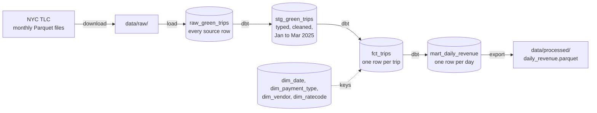

# NYC Green Taxi Daily Revenue Pipeline

[](https://github.com/jolennd/mle-data-pipeline/actions/workflows/tests.yml)
[](#run-the-checks)
[](#setup)
[](#data-flow)
[](#data-flow)
[](#tools-and-why-i-used-them)
[](#follow-a-run)
[](#run-with-docker)

An ELT pipeline that downloads the NYC Green Taxi trip records for January to March 2025, loads them into DuckDB, models them with dbt into a star schema, and produces revenue per day. Prefect orchestrates the runs.

## What it does

- **Downloads** the three monthly Parquet files from the NYC TLC into a local staging folder. Existing files are reused, and a broken or failed download stops the run.
- **Loads** every source row unchanged into DuckDB (`raw_green_trips`). Each month is replaced in one transaction, so a rerun gives the same rows.
- **Transforms** the data with dbt: a cleaned staging table, a star schema with one row per trip, and a daily revenue mart.
- **Checks itself:** raw row counts match the source files, and the revenue totals match across staging, fact table and mart (to the cent). 30 dbt data tests and 61 Python tests run on every change.
- **Exports** the result to `data/processed/daily_revenue.parquet`: 90 days, 146,475 trips, revenue 3,395,290.56.
- **Runs with or without Prefect:** the same functions run from a plain command or as a Prefect flow with retries and a monthly schedule.

## Project Brief

This project builds a data pipeline that processes the `Green Taxi Trips` portion of the [NYC Taxi Trip dataset](https://www.nyc.gov/site/tlc/about/tlc-trip-record-data.page).

1. Writes a script that downloads the data for the first three months of 2025 and stores it in a local staging directory.
2. Writes an ELT pipeline that reads the locally staged files, processes the data, and calculates revenue per day.
3. Uses Prefect for workflow orchestration.

## Tools and why I used them

| Area           | Choice                                       | Why                                                                                                                                                              |
| -------------- | -------------------------------------------- | ---------------------------------------------------------------------------------------------------------------------------------------------------------------- |
| Extract, load  | `requests`, `click`, DuckDB's Parquet reader | `requests` downloads the monthly files, `click` turns each step into a command with options, and DuckDB reads Parquet without pandas in between.                 |
| Database       | `duckdb`                                     | Runs inside Python as a single local file, with no server to start. It reads Parquet directly, and three months of taxi data fits easily.                        |
| Transform      | `dbt` (DuckDB adapter)                       | ELT means transforming in SQL inside the database. dbt gives versioned SQL models, built-in data tests and a clear build order from raw to staging to mart.      |
| Orchestrator   | `prefect`                                    | Adds tasks, retries, a run parameter (the month), a schedule and a local UI without changing the pipeline code.                                                  |
| Environment    | `uv`, `make`                                 | `uv` installs Python 3.13 and the locked dependencies. `make` is the single entry point for every command and loads the settings from `.env`.                    |
| Tests          | `pytest`, dbt tests                          | Python tests use small fixture files and a fake download, so they never touch the network. dbt tests check keys, ranges and the revenue totals on the real data. |
| Lint and types | `ruff`, `ty`                                 | Consistent formatting and lint, plus type checks.                                                                                                                |
| CI             | GitHub Actions                               | Runs lint and the fast tests on every push and pull request.                                                                                                     |

## Data Flow



All tables live in one DuckDB file, `data/warehouse.duckdb`. A null code (for example a missing payment type) maps to an `Unknown` row with key `-1`, so no trip is lost in a join.

## Project Structure

```
mle-data-pipeline/
├── data/
│   ├── raw/              # staged Parquet downloads, never edited (git-ignored)
│   └── processed/        # daily revenue output exported from the mart
├── notebooks/            # data exploration only, not part of the pipeline
├── src/
│   └── data_pipeline/    # download, load, export, plain entry point
├── transform/            # dbt project: staging, star schema, mart, seeds, tests
├── flows/                # Prefect flows and their entry point
├── tests/                # unit and integration tests
├── docs/                 # brief, traceability, data sources, design, ADRs
├── Dockerfile            # pipeline image
├── compose.yaml          # Prefect server, flow and pipeline services
├── Makefile              # run, test, orchestration and Docker targets
├── pyproject.toml        # project configuration and dependencies
└── uv.lock               # dependency lock file
```

| File / Folder                             | Description                                                                                                 |
| ----------------------------------------- | ----------------------------------------------------------------------------------------------------------- |
| `data/raw/`                               | Monthly Green Taxi Parquet files for Jan to Mar 2025, as downloaded.                                        |
| `data/processed/`                         | Daily revenue result written by the pipeline.                                                               |
| `notebooks/`                              | Exploration of columns, types, missing values and value ranges, plus analytical queries on the star schema. |
| [`src/data_pipeline/`](src/data_pipeline) | Python package: download, load into DuckDB, export, entry point.                                            |
| [`transform/`](transform)                 | dbt project: staging, star schema (`fct_trips`, dimensions, seeds) and `mart_daily_revenue`.                |
| [`flows/`](flows)                         | Prefect flows with download, load, transform and export tasks.                                              |
| [`tests/`](tests)                         | Tests for download, load, transform, reconciliation and the flows.                                          |
| [`docs/`](docs)                           | Project brief, traceability table, data sources, design notes and ADRs.                                     |
| [**pyproject.toml**](pyproject.toml)      | Project configuration and dependencies.                                                                     |
| [**uv.lock**](uv.lock)                    | Dependency lock file.                                                                                       |

### Additional Info

- The Prefect flow lives in `flows/` at the repository root instead of inside `src/data_pipeline/`. This keeps orchestration separate from the pipeline logic, which runs on its own without Prefect.
- The SQL transforms live in a dbt project in `transform/`. dbt needs its own project folder, so the transform stage is not a Python module in `src/`.

## Setup

Use [uv](https://docs.astral.sh/uv/getting-started/installation/) 0.13.5 or newer and Python 3.13.17 or a newer 3.13 patch release, as defined in [`.python-version`](.python-version).

```bash
git clone https://github.com/jolennd/mle-data-pipeline.git
cd mle-data-pipeline
uv sync
cp .env.example .env
```

`.env` holds the local settings (database file, months, folders). It is git-ignored, and no API key is needed: the source data is public.

## How to Run

All commands go through `make`, which loads `.env`. Settings are never hard-coded.

### Plain pipeline

Run download, load, transform and export once per month. Run all three months before reading daily totals, because a day is complete only after every month is loaded:

```bash
make pipeline-run PARTITION=2025-01
make pipeline-run PARTITION=2025-02
make pipeline-run PARTITION=2025-03
```

### Prefect flow

```bash
make flow-run PARTITION=2025-01   # one month
make flow-run PARTITION=all       # January to March, one after another
make flow-serve                   # serve the monthly schedule (keeps running, Ctrl+C to stop)
```

### Run with Docker

The image runs the pipeline as a batch (no port, no API). Data (downloads, database, results) lives in a Docker named volume called `data`, so it is separate from your working folder.

```bash
make docker-build                      # build the image
make docker-flow                       # start the Prefect server, then run all months through it
make docker-pipeline PARTITION=2025-01 # plain entry point, one month, no Prefect
make docker-results                    # list the exported files in the volume
make docker-down                       # stop the server, keep the data
make docker-clean                      # delete the data volume (asks first)
```

The Prefect UI for container runs is at http://127.0.0.1:4201. Run `docker-flow` and `docker-pipeline` one at a time, because the database allows a single writer. Settings (database path, months, folders) are in the `environment` block of `compose.yaml`. `make docker-test` builds the image and runs a small synthetic month inside it, with no network.

### Follow a run

Each month runs as a flow named `green-trips-<month>` with four tasks in order: download, load, transform (dbt seed, run and test) and export. Only the download retries (3 times, 60 seconds apart), because it is the only step that touches the network. A failed step stops the run, and the steps after it do not start. `green-trips-all` runs the three months one after another.

To browse runs, task states and logs in the Prefect UI, start the server in a second terminal and open http://127.0.0.1:4200:

```bash
make orch-server        # keep this terminal open, Ctrl+C to stop
```

If a run later reports "Failed to reach API", run `make orch-clean` and try again.

### Change the reporting period

1. In `.env`, set `PARTITIONS` to the months to load, for example `PARTITIONS=2025-01,2025-02,2025-03,2025-04`.
2. In `transform/dbt_project.yml`, set `range_start` and `range_end` (the end date is excluded), for example `"2025-01-01"` and `"2025-05-01"`. The date dimension follows these values.
3. Run each new month with `make pipeline-run PARTITION=<YYYY-MM>`, or all of them with `make flow-run PARTITION=all`.

Rerunning a month replaces its rows; it never appends duplicates.

With Docker, the months come from `compose.yaml` instead of `.env`: edit `PARTITIONS` there and the range in `transform/dbt_project.yml`, then run `make docker-build` so the image picks up the change.

## Run the checks

```bash
make lint             # ruff lint and format check
make test             # Python tests (unit and integration)
make transform-test   # dbt data tests, after the pipeline has loaded data
make validate-gates   # lint plus the fast tests, the same check CI runs
```

The Python tests use small synthetic Parquet files in temporary folders and a fake download, so they never use the network or the real database.

## Results and limitations

The result is written to `data/processed/daily_revenue.parquet` with one row per pickup date (`pickup_date`, `revenue`, `trip_count`). After January to March are loaded:

| Check                                           | Value        |
| ----------------------------------------------- | ------------ |
| Source rows read                                | 146,486      |
| Trips kept (pickups from Jan 1 to Mar 31, 2025) | 146,475      |
| Rows excluded, counted and logged               | 11           |
| Days                                            | 90           |
| Total revenue                                   | 3,395,290.56 |

- **Revenue is the recorded `total_amount`:** fares, fees, tolls and card tips as charged, including refunds and voids as negative rows. It is not profit, and cash tips are not recorded in the source.
- **A day is complete only after all months are loaded,** because a monthly file also contains trips from the neighbouring month.
- **One writer at a time:** DuckDB allows a single writing process, so months run one after another. Close any notebook or tool that has the database open before running the pipeline.
- **Zones are numbers:** pickup and dropoff locations are kept as TLC zone ids, without a zone-name dimension.

## Challenges and decisions

- **Neighbouring months.** The monthly files contain trips from neighbouring months, for example January 31 trips in the February file. The day comes from the pickup date, not the file, so a day is complete only after all months are loaded. I load one month at a time, and I read daily totals only after all three have run (ADR 2). Eleven rows fall outside January to March and are excluded in staging, counted and logged.
- **Negative reversals.** Between 153 and 165 rows per month have a negative `total_amount`. Most have a positive twin, but not all of them do. Filtering them would overstate revenue, so I sum them as they are and document it (ADR 1).
- **No natural key.** The data has no id column, so I could not deduplicate on a key. I checked that no month has exact duplicate rows, and I decided to stop and report if one ever does instead of dropping rows silently (ADR 13, ADR 15).
- **The package was not installed.** The tests passed because pytest adds `src/` to the import path, but `make download` failed with `No module named 'data_pipeline'`. `pyproject.toml` had no build system, so `uv sync` never installed the package. Adding hatchling as the build backend fixed the commands and let the Prefect flows import the package too.
- **One writer in DuckDB.** The file database allows one writer at a time, so months run one after another, also in the Prefect parent flow.

## Documentation and credits

- **Design and decisions:** [`docs/00-project-brief.md`](docs/00-project-brief.md) (brief and acceptance numbers), [`docs/01-traceability.md`](docs/01-traceability.md) (requirements and their tests), [`docs/02-data-sources.md`](docs/02-data-sources.md) (source details and data findings), [`docs/03-design.md`](docs/03-design.md) (components and handoffs) and [`docs/adr/`](docs/adr) (architecture decision records).
- **Data:** NYC Taxi and Limousine Commission (TLC) [trip record data](https://www.nyc.gov/site/tlc/about/tlc-trip-record-data.page). Code names for payment types, vendors and rate codes come from the [TLC data dictionary for green trips](https://www.nyc.gov/assets/tlc/downloads/pdf/data_dictionary_trip_records_green.pdf).
- **License:** [MIT](LICENSE).
